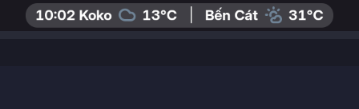

# City Clock & Weather

City Clock & Weather puts local times and current weather for your chosen cities in one GNOME top-panel indicator. You can choose a display name for each city while keeping its weather location and time zone separate.



The extension targets GNOME Shell 51. It uses Open-Meteo for current conditions and needs no API key.

## Why I built it

I wanted to see my gf local time and weather alongside mine. GNOME did not offer a way to show two clocks and two weather locations together, so I made this extension.

## Features

- Show a city's local time, display name, weather, or any combination.
- Choose the panel section and position.
- Use 12-hour, 24-hour, or the system clock format.
- Show temperatures in Celsius or Fahrenheit.
- Follow GNOME's accent color for weather icons, or choose a custom icon color.
- Set indicator opacity and weather refresh interval.
- View feels-like temperature, humidity, wind speed, and update time in the menu.

## Install

There is no release bundle yet, so build the extension from source. You need GNOME Shell 51, Node.js 20 or newer, GLib schema tools, and `gnome-extensions`.

```sh
git clone https://github.com/hwngtr/city-clock-weather.git
cd city-clock-weather
make package
gnome-extensions install --force dist/city-clock-weather@hwngtr.github.io.shell-extension.zip
gnome-extensions enable city-clock-weather@hwngtr.github.io
```

After installation, open the indicator menu and choose **Settings** to add your cities. You can also open the settings from a terminal:

```sh
gnome-extensions prefs city-clock-weather@hwngtr.github.io
```

## Configure cities

Open **City Clock & Weather settings** from the panel indicator. Search for a city or place, choose a result, and edit its display name before adding it. The selected result fills in its weather location, coordinates, and time zone.

You can also edit the city list directly. Use this format:

```text
Display name:Weather location:latitude:longitude:IANA time zone:show clock:show weather:show name
```

Separate entries with semicolons. Set each of the last three fields to `1` to show it or `0` to hide it. For example:

```text
Home:London:51.5072:-0.1276:Europe/London:1:1:1;Office:Tokyo:35.6762:139.6503:Asia/Tokyo:0:1:0
```

The panel shows the local time, the name “Home”, temperature, and weather icon for London. Tokyo shows weather only. A vertical bar separates each city group.

The field separator characters `:` and `;` cannot appear inside a city name or time-zone name.
You can remove all entries and apply an empty list. The panel then shows **Add a city**, which opens the settings.

## Privacy

When you search for a place, the extension sends the search text to `geocoding-api.open-meteo.com`. Weather requests send selected coordinates, time zones, requested weather fields, and temperature units to `api.open-meteo.com`. These requests expose your network address to Open-Meteo. The extension does not send your display names, GNOME account details, or API credentials. Weather results stay in the local cache directory for this extension.

## Build and test

To run the checks, use Node.js 20 or newer and GLib schema tools:

```sh
make check
```

Run `make verify` after installation to confirm that GNOME loaded the extension without errors. If the extension does not appear on Wayland, log out and log in again.

The bundle is written to `dist/city-clock-weather@hwngtr.github.io.shell-extension.zip`. It contains the extension files and schema XML, not the test suite or repository documentation.

## License

This project is available under the MIT License. See [LICENSE](LICENSE).
